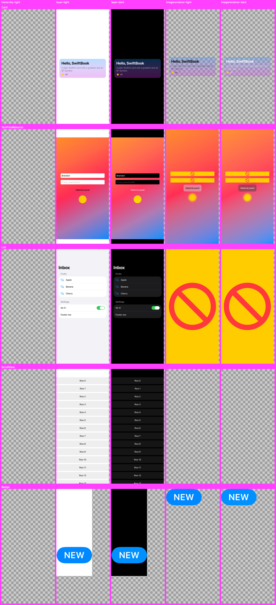
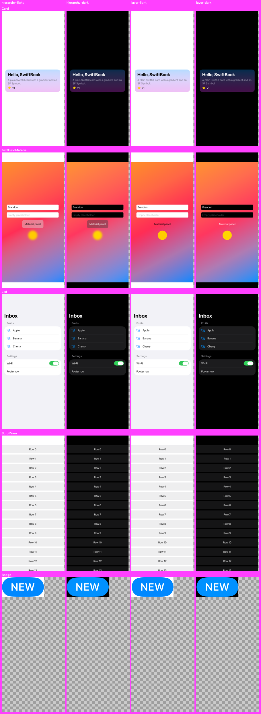

# Spike: iOS renderer in the Simulator

**Date:** 2026-10-02.
**Environment:** Xcode 27.0, Swift 6.4, iOS 27 simulator runtime. No tvOS runtime was installed.

**Question:** can the macOS viewer run an iOS renderer process in the Simulator, built from a plain SwiftPM package with no user-provided Xcode project or app target, that stays alive and serves render requests?

**Answer:**
- **Yes, but only as a real app process.** A long-running xctest server works mechanically, but `drawHierarchy` produces blank images without a host app.
- **A minimal app built from SwiftPM renders everything correctly.**
- **Speed:** from editing a source file to a new PNG takes about 2.8–3.2 s on every path tried.

## Fidelity

*No host app.* Columns, left to right: `drawHierarchy` light, `layer.render` light and dark, `ImageRenderer` light and dark. `drawHierarchy` is blank; the log says "Render server returned error for view (UIWindow)".

*App host.* Columns, left to right: `drawHierarchy` light and dark, `layer.render` light and dark.

| Method | No host (xctest) | App host |
|---|---|---|
| `drawHierarchy(in:afterScreenUpdates:)` | Blank | **Correct**, including List, TextField, Toggle, material and blur |
| `layer.render(in:)` | Mostly right; material and `.blur` missing | Same as no host |
| `ImageRenderer` | List and TextField show placeholders; ScrollView blank | Same |

Making the xctest process an app by calling `UIApplicationMain` hangs. That is a dead end.

## Timing (warm simulator, tiny demo package)

| Step | Time |
|---|---|
| Cold build (xctest / `swift build` + bundle / `.iOSApplication`) | 8.2 s / 7.4 s / 7.6 s |
| No-op rebuild | 1.4–1.5 s |
| Launch to first render | 1.0–1.6 s (2.6 s on the first run after the simulator boots) |
| **Edit → new PNG**, xctest / `swift build` app / `.iOSApplication` | **3.2 s / 2.8 s / 2.8 s** |
| Warm render, `drawHierarchy`, full screen @3x (includes the two-frame stability wait and PNG encode) | 180–590 ms |

Real packages will spend longer compiling the module that changed.

## Ways to build a host app

1. **`.iOSApplication` product (AppleProductTypes) in a generated `.swiftpm` package** that depends on the user's package by path. Build with `xcodebuild`, then `simctl install` and `simctl launch`.
   - Apple generates the Info.plist, the scene manifest, and the SDK version stamp.
   - **It works only if the directory name ends in `.swiftpm`**, which is undocumented behavior.
   - `swift build` can't read this kind of manifest.
2. **`swift build` cross-compile plus our own `.app` wrapper**, with no dependencies and no xcodebuild. See [build-app.sh](ios-renderer/build-app.sh) and [bundle-app.sh](ios-renderer/bundle-app.sh). Gotchas:
   - **The binary is stamped with the wrong SDK version.** SwiftPM stamps the deployment target as the SDK version, and UIKit adjusts its behavior to match: List section headers rendered in iOS 18 style. Fix it with `vtool -set-build-version iossim <min> <sdk> -replace`, then re-sign ad hoc.
   - **SDK 27 requires the UIScene lifecycle.** Without a scene manifest and a scene delegate, launch hangs.
3. **A long-running xctest server** (`build-for-testing` + `test-without-building`).
   - **What works:** the server survived 13 minutes, discovery took about 20 ms, and the simulator shares the host's loopback interface.
   - **Timeouts:** pass `-test-timeouts-enabled NO`. With timeouts enabled, xcodebuild kills the test and starts a slow `simctl diagnose`.
   - **Blocker:** rendering is not faithful (see [Fidelity](#fidelity)).

## Other findings

- **Extracting the view from `Preview` works** for plain previews and `@Previewable`. The path is `Mirror` → `dataSource.preview.structure.singlePreview.makeBody`. The closure's private result type is read from function-type metadata (offset 16) and opened with `_openExistential`; the code then searches the result for an `any View`. Not yet tested: `PreviewModifier`, `arguments:` previews, and multi-preview `PreviewProvider`.
- **`.sizeThatFitsLayout` needs `hostingController.safeAreaRegions = []`** before measuring. Otherwise the safe area inflates the size.
- **Background transparency:** `drawHierarchy` and `layer` output has an opaque window background. Only `ImageRenderer` keeps transparency.
- **Scheme naming:** a package with more than one product gets the scheme `<Pkg>-Package`, and the `.xctestrun` filename follows it.
- **No host app:** `UIApplication.shared` crashes the process.

## Not verified

- tvOS at runtime. The renderer compiles for the tvOS simulator.
- Whether the `.swiftpm` behavior holds in other Xcode versions.
- Pixel determinism across runs.
